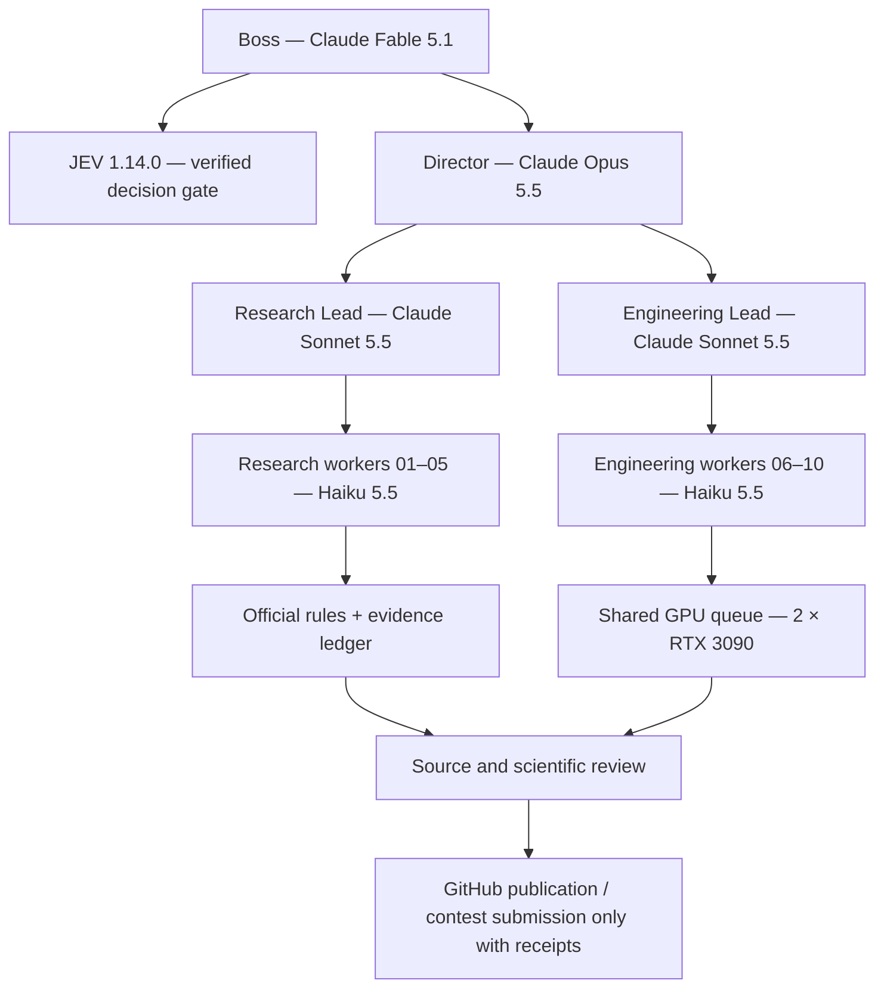

# Server-IA Competition Autonomy — audited OpenClaw deployment

  

**Project:** Server-IA Hierarchical Competition Research and Verification
**Date:** 2026-11-03
**Original author:** Francisco Angulo de Lafuente — [ORCID 0009-0001-1634-7063](https://orcid.org/0009-0001-1634-7063)

**License for these new files:** MIT. Retain this author and license notice in derivative works. Do not represent someone else's measurements, third-party data, or submissions as your own.

## Purpose

This deployment connects OpenClaw's hierarchical agents to a verified TypeSafe JEV strategy oracle, recurring multilingual competition discovery, a shared two-GPU scientific queue, and evidence-gated publication and submission procedures. It does **not** claim that research, training, or contest entry occurred unless a provider or scheduler receipt exists.



## Components

| Component | Status on 2026-11-03 | Verification |
|---|---|---|
| OpenClaw gateway | Running | systemd user service active; OpenClaw 2026.10.9 |
| 20-language discovery | Running every five hours | Last scout: 285 unverified discovery candidates |
| Hierarchical model registration | Configured | 15 defined agent IDs including 10 Haiku workers |
| Live LLM API | Working | Worker-01 Haiku 5.5 response, provider recorded, cost estimate USD 0.0030081 |
| Native subagent delegation | Working for one lead/worker pair | Research Lead spawned Worker-01; run ID `38e3fea2-f5cb-4914-87a9-061b309edc18` |
| JEV on Server-IA | Working | Real JEV 1.14.0 JSON receipt, no reliance on Windows after setup |
| Automated competition verification | Demonstrated | Codabench and Virtual Cell reports written by agent workers |
| GPU competition training | **Not verified** | Two RTX 3090 GPUs idle at last inspection; no compliant training lease |
| Official contest entry from this deployment | **Not verified** | Initial Gmail reconciliation revealed pre-existing organizer receipts |
| Full top-down hierarchy | One real run completed | Boss Fable -> Director Opus -> Research/Engineering Leads Sonnet -> five Haiku workers; first boss native cron receipt 2026-11-03 21:51 UTC |

## Installed Server-IA paths

- `/home/ai/.openclaw/openclaw.json` — OpenClaw agent hierarchy. Keep this configuration and its credentials private.
- `/home/ai/.openclaw/skills/cognitiva-hierarchical-competitions/SKILL.md` — extended Cognitiva scientific policy.
- `/srv/openclaw/competition-code/competition_scout.py` — deterministic 20-language discovery, every five hours.
- `/srv/openclaw/competition-code/jev_oracle_query.py` — installed, tested TypeSafe SDK bridge.
- `/srv/openclaw/competition-state/AUTONOMOUS_MISSION.md` — active hierarchical mission.
- `/srv/openclaw/competition-state/agent-results/` — experimental evidence and audit ledger.
- `/home/ai/servidor-ia/cola.py` — existing GPU lease queue, which must not be bypassed.

## Restore the TypeSafe SDK environment

Install to an isolated interpreter on the data disk (never commit API keys):

```bash
python3 -m venv /mnt/datos/openclaw/venvs/jev-oracle
/mnt/datos/openclaw/venvs/jev-oracle/bin/python -m pip install -r requirements.txt
chmod 700 /srv/openclaw/competition-code/jev_oracle_query.py
```

Create the protected credential file through an authenticated secret transfer; do not paste keys in shell histories or the repository:

```bash
chmod 700 /home/ai/.openclaw
chmod 600 /home/ai/.openclaw/jev.key
```

Run one bounded decision with private state/questions JSON inputs in the competition-state directory:

```bash
/mnt/datos/openclaw/venvs/jev-oracle/bin/python \
  /srv/openclaw/competition-code/jev_oracle_query.py \
  --state-file /srv/openclaw/competition-state/jev-initial-state.json \
  --questions-file /srv/openclaw/competition-state/jev-initial-questions.json \
  --out-file /srv/openclaw/competition-state/jev-first-live-receipt.json
```

The tool permits `choice`, `score`, and `noul` question types and writes an atomic receipt with request SHA-256, provider model and usage. It does not turn a model recommendation into legal permission to submit or train.

## Native recurring jobs

Configured on the live OpenClaw Gateway, isolated from one another:

| Job | Role | Frequency | Declaration key |
|---|---|---|---|
| `competition-boss-orchestration-5h` | Fable Boss | Every 5 hours | `competition-boss-orchestration-v1` |
| `competition-lead-execution-hourly` | Sonnet Research Lead | Every hour | `competition-lead-execution-v1` |
| `competition-director-quality-gate-2h` | Opus Director | Every 2 hours | `competition-director-review-v1` |

The existing five-hour systemd scout is independent from agent turns; both must remain healthy. Use stable declaration keys to avoid duplicate jobs. Verify completion in `openclaw cron runs`, not merely `openclaw cron list`.

## Research and safety guarantees

1. Reconcile **previous organizer receipts and contest accounts** before creating applications. The initial organizer mail inventory is private: `verified-gmail-inventory-20261103.json` under Server-IA state, never this public repository.
2. For each contest, validate official eligibility, deadlines, pre-existing-code rules, submission format and prizes. Unverified Google News RSS items are only leads.
3. Compare candidate foundations from [Agnuxo1](https://github.com/Agnuxo1) with cited literature and permitted open-source baselines. Reuse validated scientific simulators; never fabricate measurements or citations.
4. Gate GPU work through the existing JEV/shared queue and resource inspection. Record seeds, datasets, commit hashes, job ownership, wall-clock time, GPU memory and metrics. Initial sprint limit: 24 hours; any extension needs new JEV evidence.
5. Require Worker → Lead → Director → Boss review for high-stakes claims, published scientific results and official submissions.
6. Avoid duplicate final submissions; retain organizer receipt IDs and email timestamps. Existing successful submission receipts must be honored.
7. Keep dataset binaries, large checkpoints, nonredistributable data and secret files off GitHub; use source archives and appropriate object/storage backup.
8. API calls must be tracked and bounded. The presence of a key does not establish that credits remain free; do not silently incur paid charges.

## Observed initial results

- A live Haiku 5.5 turn succeeded.
- A Sonnet 5.5 research agent created a sourced Codabench verification brief.
- Research Lead spawned Haiku Worker-01, which created a Virtual Cell official-rules report.
- The JEV oracle was queried *on the Linux server* and returned a signed-request-hash-associated receipt recommending official-rule verification first and guarded shared GPU usage.

The system has **completed a live full top-down research delegation cycle** but remains partially operational for experiments, Gmail automation and contest submissions; it is not yet a proven fully autonomous contest submission pipeline. Please do not describe it as automatically winning competitions or running GPU models until an actual training/contest receipt verifies that step.

## Attribution and citation

Copyright © 2026 Francisco Angulo de Lafuente. ORCID: [0009-0001-1634-7063](https://orcid.org/0009-0001-1634-7063). **MIT License** for original bridge, policies and documentation supplied under this folder. Keep original OpenClaw authorship and third-party licenses intact. Responsible reuse requires preservation of notices; a license notice does not guarantee that all derivative users will provide academic citations.


## Evidence update ? completed full hierarchy and CUDA hardware checks

The first Fable Boss scheduler run on 3 Nov 2026 (21:39?21:52 UTC)
completed successfully, spawned an Opus Director, which spawned two Sonnet
leads and five Haiku workers. Each worker's own source-backed output was
observed on Server-IA. This verifies research delegation but not automatic
contest submission. The Gmail connector snapshot independently confirmed two
already-scored Virtual Cell entries; the Boss's original missing-registration
conclusion was corrected with a second real JEV decision.

A bounded CUDA smoke test ran on *both* RTX 3090 cards with PyTorch
2.14.1+cu130, 768?768 matmul, 14.9 MiB peak allocated per isolated worker.
Both succeeded with deterministic checksum 113069976.0. See
[GPU evidence](evidence/2026-11-03-gpu-selftest.json).
The diagnostic is not a training benchmark, and GPU competition training
remains gated by scientific evidence and the existing shared queue.

The separate [Sleep Onset scientific audit](https://github.com/Agnuxo1/holographic-reservoir-sleep-onset/blob/main/experiments/SERVER_IA_REPRODUCTION_20261103.md)
documents the successful synthetic model-ladder tests after pinning the
missing public PyPI Holographic Reservoir dependency, together with the
limitations of the still-unreproduced official score.
